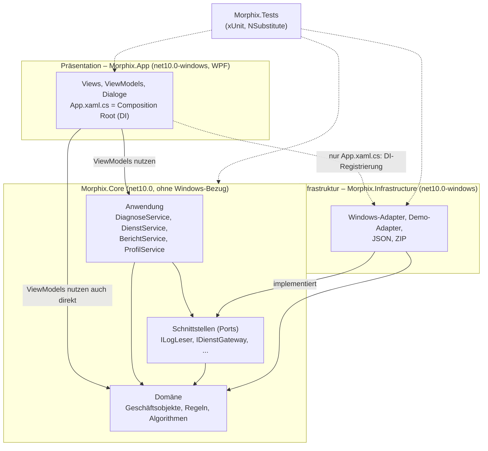
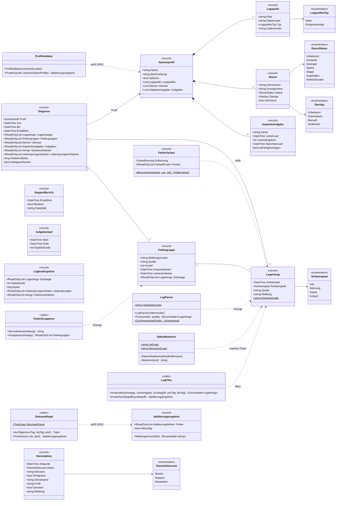
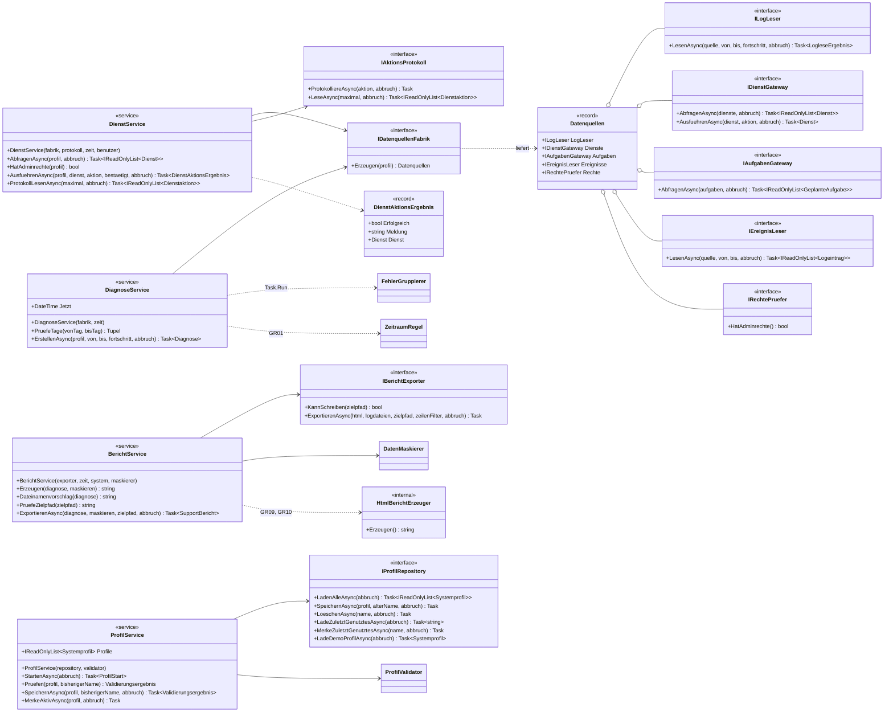
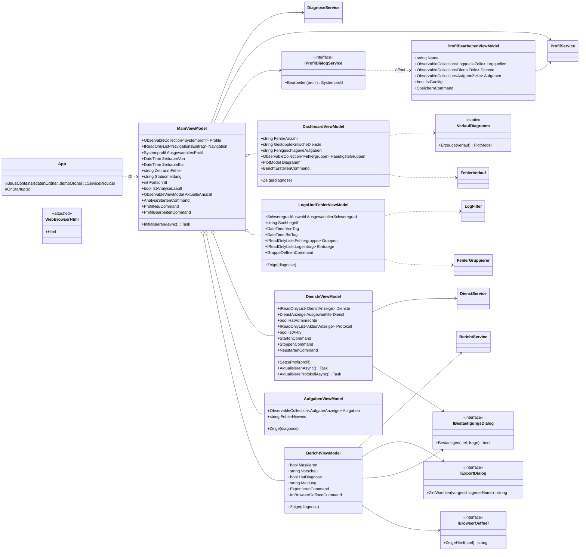
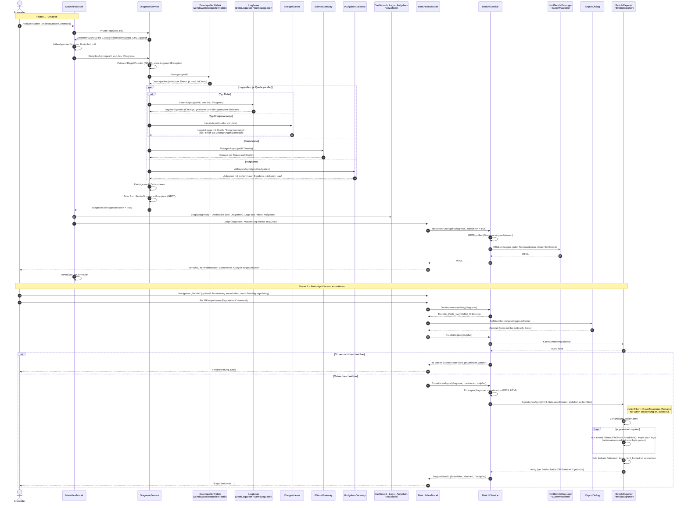

# Morphix – Architektur im Ist-Zustand

Stand: Version 1.1 (Tag `v1.1`, Commit `c198e9d`). Dieses Dokument beschreibt, wie Morphix **tatsächlich** gebaut ist. Es
ergänzt das Architekturdokument (`docs/Morphix – Architekturdokument (Entwurf).pdf`), ersetzt dessen Entwurfsdiagramme
(`schichten.png`, `klassen.png`, `sequenz.png` liegen nicht im Repository) und listet in Abschnitt 4 alle Abweichungen. Bei
Widersprüchen zwischen Dokumenten gilt weiterhin die Regel aus `CLAUDE.md`: Die Dokumente in `docs/` haben Vorrang vor
`CLAUDE.md`; bewusste Abweichungen stehen zusätzlich in `docs/AENDERUNGEN.md`, offene Punkte in `docs/TECHNICAL_DEBT.md`.

Lesehilfe zu den Diagrammen: Typen mit `?` (Nullable) sind ohne Fragezeichen geschrieben, `Task~T~` bedeutet `Task<T>`.
Es sind jeweils die wichtigsten Attribute und Methoden aufgeführt, nicht alle. Namen sind wie im Code (deutsch, ohne Umlaute).

---

## 1. Klassendiagramme je Schicht

### 1.1 Schichten und Abhängigkeiten

### 1.2 Domäne (Morphix.Core/Domaene)

### 1.3 Schnittstellen (Ports) und Anwendung (Morphix.Core/Schnittstellen und Anwendung)

### 1.4 Infrastruktur (Morphix.Infrastructure)

```mermaid
classDiagram
    direction TB

    class WindowsDatenquellenFabrik {
        +WindowsDatenquellenFabrik(demoOrdner, windowsDienste, windowsRechte)
        +Erzeugen(profil) Datenquellen
    }

    class DateiLogLeser {
        +LesenAsync(quelle, von, bis, fortschritt, abbruch) Task~LogleseErgebnis~
    }
    class DemoLogLeser {
        +DemoLogLeser(demoOrdner, jetzt)
        +LesenAsync(quelle, von, bis, fortschritt, abbruch) Task~LogleseErgebnis~
    }

    class WindowsDienstGateway {
        +TimeSpan StandardTimeout$
        +WindowsDienstGateway(zugriff, timeout)
        +AbfragenAsync(dienste, abbruch) Task~IReadOnlyList~Dienst~~
        +AusfuehrenAsync(dienst, aktion, abbruch) Task~Dienst~
    }
    class IDienstZugriff {
        <<interface>>
        +Oeffnen(dienstname) IDienstHandle
    }
    class ServiceControllerZugriff
    class DemoDienstGateway {
        +DemoDienstGateway(dienste, verzoegerung)
    }

    class WindowsAufgabenGateway {
        +AbfragenAsync(aufgaben, abbruch) Task~IReadOnlyList~GeplanteAufgabe~~
    }
    class IAufgabenZugriff {
        <<interface>>
        +Lesen(aufgabenname) AufgabenZustand
    }
    class TaskSchedulerZugriff
    class DemoAufgabenGateway

    class WindowsEreignisLeser {
        +int MaxEreignisse$
        +LesenAsync(quelle, von, bis, abbruch) Task~IReadOnlyList~Logeintrag~~
    }
    class IEreignisZugriff {
        <<interface>>
        +Lesen(protokoll, von, bis, maximal, abbruch) IReadOnlyList~RohEreignis~
    }
    class EventLogZugriff
    class DemoEreignisLeser

    class WindowsRechtePruefer {
        +HatAdminrechte() bool
    }
    class DemoRechtePruefer {
        +HatAdminrechte() bool
    }

    class JsonProfilRepository {
        +JsonProfilRepository(profilOrdner, einstellungsDatei, demoProfilDatei)
    }
    class HtmlZipExporter {
        +KannSchreiben(zielpfad) bool
        +ExportierenAsync(html, logdateien, zielpfad, zeilenFilter, abbruch) Task
    }
    class JsonLinesAktionsProtokoll {
        +JsonLinesAktionsProtokoll(pfad)
        +ProtokolliereAsync(aktion, abbruch) Task
        +LeseAsync(maximal, abbruch) Task~IReadOnlyList~Dienstaktion~~
    }

    ILogLeser <|.. DateiLogLeser
    ILogLeser <|.. DemoLogLeser
    DemoLogLeser ..> DateiLogLeser : liest, verschiebt Zeitstempel
    IDienstGateway <|.. WindowsDienstGateway
    IDienstGateway <|.. DemoDienstGateway
    WindowsDienstGateway --> IDienstZugriff
    IDienstZugriff <|.. ServiceControllerZugriff
    IAufgabenGateway <|.. WindowsAufgabenGateway
    IAufgabenGateway <|.. DemoAufgabenGateway
    WindowsAufgabenGateway --> IAufgabenZugriff
    IAufgabenZugriff <|.. TaskSchedulerZugriff
    IEreignisLeser <|.. WindowsEreignisLeser
    IEreignisLeser <|.. DemoEreignisLeser
    WindowsEreignisLeser --> IEreignisZugriff
    IEreignisZugriff <|.. EventLogZugriff
    IRechtePruefer <|.. WindowsRechtePruefer
    IRechtePruefer <|.. DemoRechtePruefer
    IProfilRepository <|.. JsonProfilRepository
    IBerichtExporter <|.. HtmlZipExporter
    IAktionsProtokoll <|.. JsonLinesAktionsProtokoll
    IDatenquellenFabrik <|.. WindowsDatenquellenFabrik
    WindowsDatenquellenFabrik ..> DateiLogLeser : echtes Profil
    WindowsDatenquellenFabrik ..> DemoLogLeser : Demo-Profil
    WindowsDatenquellenFabrik ..> WindowsDienstGateway
    WindowsDatenquellenFabrik ..> DemoDienstGateway : je Profil gemerkt
```

Die Zugriffsschnittstellen `IDienstZugriff`, `IAufgabenZugriff` und `IEreignisZugriff` sind eine zusätzliche Nahtstelle *innerhalb*
der Infrastruktur: Sie kapseln `ServiceController`, TaskScheduler und `EventLogReader`, damit die Logik der Adapter ohne echtes
System mit Fakes getestet werden kann. Die Zugriffsklassen selbst (`ServiceControllerZugriff`, `TaskSchedulerZugriff`,
`EventLogZugriff`) sind nicht automatisch getestet.

### 1.5 Präsentation (Morphix.App)

Alle ViewModels erben von `ObservableViewModel` (CommunityToolkit.Mvvm `ObservableObject`). Die DataTemplates in `App.xaml` ordnen
jedem ViewModel-Typ seine View zu; die Navigation tauscht nur das ViewModel (`MainViewModel.AktuelleAnsicht`). Die Views haben keine
Logik im Code-Behind; die einzige Ausnahme ist die Attached Property `WebBrowserHtml.Html` (reines View-Verhalten).

---

## 2. Sequenzdiagramm: „Analyse starten“ bis „Als ZIP exportieren“

Der Ablauf besteht aus zwei Phasen, die der Anwender nacheinander auslöst: die Analyse (Klick auf „Analyse starten“) und der Export aus der
Ansicht „Bericht“. Die Berichtsvorschau entsteht automatisch am Ende der Analyse. Die Dienste-Aktionen (Start, Stopp, Neustart) gehören nicht zu diesem Ablauf.

Kernpunkte des tatsächlichen Ablaufs:

- Logquellen, Dienststatus und Aufgaben werden **parallel** erfasst (`Task.WhenAll`); Ereignisprotokolle sind Logquellen vom Typ
  Ereignisanzeige und laufen im selben Zweig. Ein nicht lesbares Ereignisprotokoll bricht die Analyse nicht ab.
- Die Fabrik entscheidet über echte oder Demo-Adapter; `DiagnoseService` kennt den Unterschied nicht.
- Die Maskierung wirkt an zwei Stellen: im HTML (`HtmlBerichtErzeuger`, vor der Kodierung) und über den Zeilenfilter beim Kopieren
  der Logdateien ins ZIP. Beides geht von `BerichtService` aus; die Originaldateien werden nur gelesen (GR05).
- Die Vorschau wird mit derselben Methode erzeugt wie der Export (`BerichtService.Erzeugen`), beim Export aber neu, damit Vorschau
  und Datei zur gewählten Maskierung passen.

---

## 3. Verwendete NuGet-Pakete

Alle Versionen stammen aus den `.csproj`-Dateien, die Lizenzen aus den `.nuspec`-Metadaten der Pakete im NuGet-Cache.
`Directory.Build.props` setzt für alle Projekte C# 14, `Nullable`, `ImplicitUsings` und `TreatWarningsAsErrors`.

### 3.1 Direkt eingebundene Pakete

| Paket | Version | Lizenz | Projekt | Einsatz |
|---|---|---|---|---|
| CommunityToolkit.Mvvm | 8.4.2 | MIT | Morphix.App | `ObservableObject`, `[ObservableProperty]`, `[RelayCommand]` |
| Microsoft.Extensions.DependencyInjection | 11.0.0 | MIT | Morphix.App | Dependency Injection in `App.xaml.cs` |
| OxyPlot.Wpf | 2.2.0 | MIT | Morphix.App | Fehlerdiagramm im Dashboard (US12) |
| System.Diagnostics.EventLog | 11.0.0 | MIT | Morphix.Infrastructure | Ereignisanzeige lesen (`EventLogReader`, US06) |
| System.ServiceProcess.ServiceController | 11.0.0 | MIT | Morphix.Infrastructure | Windows-Dienste abfragen und steuern |
| TaskScheduler | 2.12.2 | MIT | Morphix.Infrastructure | Aufgabenplanung lesen (US10) |
| Microsoft.NET.Test.Sdk | 18.11.1 | MIT | Morphix.Tests | Testhost |
| xunit | 2.9.3 | Apache-2.0 | Morphix.Tests | Testframework |
| xunit.runner.visualstudio | 4.0.1 | Apache-2.0 | Morphix.Tests | Testadapter für `dotnet test` und Visual Studio |
| NSubstitute | 6.2.0 | BSD-3-Clause | Morphix.Tests | Test-Doubles (Fakes) |
| coverlet.collector | 10.1.0 | MIT | Morphix.Tests | Abdeckungsmessung |

`Morphix.Core` bindet **kein** Paket ein.

### 3.2 Wichtige transitive Pakete

| Paket | Version | Lizenz | Kommt von | Bemerkung |
|---|---|---|---|---|
| OxyPlot.Core | 2.2.0 | MIT | OxyPlot.Wpf | liegt in `release/` (`OxyPlot.dll`) |
| OxyPlot.Wpf.Shared | 2.2.0 | MIT | OxyPlot.Wpf | liegt in `release/` |
| Microsoft.Extensions.DependencyInjection.Abstractions | 11.0.0 | MIT | Microsoft.Extensions.DependencyInjection | liegt in `release/` |
| xunit.core, xunit.assert (und weitere) | 2.9.3 | Apache-2.0 | xunit | nur Tests |
| weitere Pakete des Test-SDK (TestPlatform) | – | meist MIT | Microsoft.NET.Test.Sdk | nur Tests, nicht ausgeliefert |

### 3.3 Bordmittel ohne Paket

`System.Text.Json` (Profile, Aktionsprotokoll), `System.IO.Compression` (ZIP-Export), `System.Net.WebUtility` (HTML-Kodierung),
`System.Security.Principal` (Administratorrechte), `System.Diagnostics.Eventing.Reader` (kommt mit dem EventLog-Paket),
WPF-`WebBrowser` (Berichtsvorschau).

### 3.4 Was ausgeliefert wird

`release/` (framework-dependent, win-x64) enthält neben den eigenen Assemblys `CommunityToolkit.Mvvm`,
`Microsoft.Extensions.DependencyInjection(.Abstractions)`, `Microsoft.Win32.TaskScheduler`, `OxyPlot`, `OxyPlot.Wpf`,
`OxyPlot.Wpf.Shared`, `System.Diagnostics.EventLog(.Messages)` und `System.ServiceProcess.ServiceController` sowie die deutschen
Bibliotheksressourcen. Testpakete werden nicht ausgeliefert. Zur Laufzeit wird die .NET 10 Desktop Runtime vorausgesetzt.

---

## 4. Abweichungen vom Architekturdokument

Gegenübergestellt sind die Vorgaben des Architekturdokuments (Kapitelnummern wie im PDF) und der Ist-Zustand. „Abweichung“ heißt:
Der Ist-Zustand widerspricht dem Dokument oder setzt es anders um. „Ergänzung“ heißt: Es gibt etwas, das das Dokument nicht
nennt, ohne ihm zu widersprechen. Die Spalte „Dokumentiert in“ nennt, wo die Entscheidung begründet ist.

### 4.1 Abweichungen

| Nr. | Kapitel | Vorgabe im Architekturdokument | Ist-Zustand | Dokumentiert in |
|---|---|---|---|---|
| A1 | 2.1 Schichten | Präsentation darf nur auf die **Anwendung** zugreifen. | ViewModels verwenden Domänentypen (`Systemprofil`, `Diagnose`, `Dienst` …) und rufen zustandslose Domänenfunktionen **direkt** auf: `LogFilter` und `FehlerGruppierer` in `LogsUndFehlerViewModel`, `FehlerVerlauf` in `DashboardViewModel`, `ZeitraumRegel`-Konstanten in `MainViewModel`. Der Compiler verhindert das nicht, weil Anwendung und Domäne beide in `Morphix.Core` liegen. | nur hier |
| A2 | 2.1 Schichten | Abhängigkeiten zeigen nur nach innen; die Präsentation kennt die Infrastruktur nicht. | `Morphix.App` hat eine **Projektreferenz auf `Morphix.Infrastructure`**. Genutzt wird sie nur in `App.xaml.cs` (Composition Root, `BaueContainer`), nirgends in Views oder ViewModels. | nur hier (vgl. Kap. 2.4: DI-Registrierung in `App.xaml.cs`) |
| A3 | 3 Struktur (`DienstService`) | „prüft GR03 (Profil, Rechte, Bestätigung) **und GR04 (Demo)**“. | GR03 prüft der `DienstService`. GR04 prüft er **nicht**: Die Fabrik liefert im Demo-Modus `DemoDienstGateway` und `DemoRechtePruefer`, die simulieren bzw. „Rechte vorhanden“ melden (kein `if (istDemo)` im Service). Der Service übernimmt `Profil.IstDemo` nur als Datum für das Aktionsprotokoll. Im Demo-Modus entfällt dadurch die Administratorrechte-Prüfung faktisch. | AENDERUNGEN §7, §12 |
| A4 | 3 Struktur / 4 Verhalten (`IBerichtExporter`, Maskierung) | Die Maskierung läuft im `BerichtService` **vor dem Export**; Schnittstelle `IBerichtExporter` exportiert „Bericht und Logs“. | Das HTML wird im `BerichtService` maskiert. Die Logkopien im ZIP maskiert der Exporter **zeilenweise beim Kopieren** über einen vom `BerichtService` übergebenen `zeilenFilter`. Dafür ist `IBerichtExporter.ExportierenAsync` um den Parameter `zeilenFilter` erweitert, und es gibt die zusätzliche Methode `KannSchreiben` (Prüfung „Exportordner beschreibbar“). | AENDERUNGEN §8 |
| A5 | 2.1 / 3 (`HtmlZipExporter`, „HTML/ZIP“-Adapter) | Die Infrastruktur enthält Adapter für „HTML/ZIP“. | Die HTML-Erzeugung liegt in `Morphix.Core` (`HtmlBerichtErzeuger`, intern in der Anwendungsschicht, aufgerufen vom `BerichtService`). `HtmlZipExporter` schreibt nur die ZIP-Datei; der Name ist irreführend, er erzeugt kein HTML. | nur hier |
| A6 | 5 Nebenläufigkeit | „Einlesen und Gruppieren per `Task.Run`.“ | Gruppieren läuft per `Task.Run` (`DiagnoseService`). Das **Einlesen** der Dateien ist asynchrones Dateilesen (`FileStream` mit `useAsync`) ohne `Task.Run`; `Task.Run` nutzen die Windows-Adapter für Dienste, Aufgaben und Ereignisse (synchrone Windows-APIs). Das **Filtern und Neugruppieren** in „Logs und Fehler“ läuft synchron im UI-Thread (gemessen: bei 1 Mio. Einträgen rund 20–45 ms). | nur hier (Messung: `testprotokoll/M8_Qualitaet.md`) |
| A7 | 2.2 Asynchrone Verarbeitung („`IProgress`“) | Langläufer melden Fortschritt über `IProgress`. | Nur die **Analyse** meldet Fortschritt. Der **ZIP-Export** läuft asynchron, aber ohne `IProgress` und ohne Abbruchmöglichkeit in der Oberfläche; ebenso die Dienstaktionen (Wartezeit bis 30 s). | TECHNICAL_DEBT Nr. 6, 15 |
| A8 | 1.2 Bibliotheken | Tabelle nennt: CommunityToolkit.Mvvm, Microsoft.Extensions.DependencyInjection, System.ServiceProcess.ServiceController, System.Diagnostics.EventLog, TaskScheduler, OxyPlot.Wpf, xUnit, NSubstitute, coverlet.collector. | Zusätzlich eingebunden: **Microsoft.NET.Test.Sdk** und **xunit.runner.visualstudio** (Test-Infrastruktur, in `CLAUDE.md` erlaubt, im Dokument nicht aufgeführt). Die Microsoft-Pakete haben Version 11.0.0, also eine höhere Hauptversion als das Zielframework .NET 10. Transitiv ausgeliefert werden außerdem `OxyPlot.Core`, `OxyPlot.Wpf.Shared` und `Microsoft.Extensions.DependencyInjection.Abstractions`. | Abschnitt 3 dieses Dokuments |
| A9 | 3 Struktur (Klassenliste, `IDatenquellenFabrik`) | Die Fabrik liefert „passend zum Profil (`istDemo`) die Datenquellen“. | Die Fabrik ist **zustandsbehaftet**: Für Demo-Profile merkt sie sich das simulierte Dienstsystem je Profil (solange sich die Dienstliste nicht ändert), damit Dienste-Ansicht und Analyse denselben Zustand sehen. Sie liefert ein `Datenquellen`-Paket, das auch den `IRechtePruefer` enthält. | AENDERUNGEN §7 |
| A10 | 3 Struktur (`MainViewModel`, Datenfluss) | `MainViewModel`: „Profil und Zeitraum wählen, Analyse starten, Navigation“. | Zusätzlich verteilt das `MainViewModel` das Analyseergebnis aktiv an die Ansichten (`Zeige(diagnose)` an Dashboard, Logs, Aufgaben, Bericht) und setzt sie beim Profilwechsel zurück. Es gibt keinen gemeinsamen Diagnose-Zustand (Service oder Store); die ViewModels sind Singletons. | nur hier |
| A11 | 5 Querschnitt: Speicherorte | Profile unter `%AppData%\Morphix\Profile`; Demo-Daten im Programmordner. | Weitere Speicherorte: `%AppData%\Morphix\einstellungen.json` (zuletzt genutztes Profil), `%AppData%\Morphix\aktionen.jsonl` (Aktionsprotokoll, US16) und `%TEMP%\Morphix\Morphix_Bericht_*.html` (Bericht im Browser, wird nach einer Stunde beim nächsten Öffnen gelöscht). | AENDERUNGEN §9, §12 |
| A12 | 5 Querschnitt: Fehlerbehandlung | „Leser fangen Ein-/Ausgabefehler je Datei ab, überspringen die Datei und sammeln eine Meldung.“ | Gilt für den `DateiLogLeser`. Über den Wortlaut hinaus: `DiagnoseService` fängt Fehler je **Ereignisprotokoll** ab, `WindowsAufgabenGateway` je **Aufgabe**, der Exporter vermerkt nicht kopierbare Logs in `logs/_nicht_kopiert.txt`. Das `WindowsDienstGateway` meldet nicht lesbare Dienste als Status „Unbekannt“. | AENDERUNGEN §8, §9 |
| A13 | 2.1 Abbildungen, 3 und 4 | Das Dokument verweist auf `schichten.png`, `klassen.png`, `sequenz.png`. | Diese drei Dateien liegen **nicht** im Repository (`docs/` enthält `UML_Diagramm.png` und `mockup-hauptfenster.png`). Dieses Dokument liefert die Ist-Diagramme als Mermaid. | – |

### 4.2 Ergänzungen (im Architekturdokument nicht genannt)

| Nr. | Bereich | Ergänzung |
|---|---|---|
| E1 | Domäne | `ProfilValidator` (GR02 und Feldregeln), `LogFilter` (US04), `FehlerVerlauf` (US12), `AnzeigeTexte`, `Systeminfo`, `LogleseErgebnis`, `Validierungsergebnis`. Der Datensatz `Aufgabenlauf` aus dem Datenmodell ist angelegt, wird aber nicht verwendet. |
| E2 | Schnittstellen | `IEreignisLeser` (Ereignisanzeige als eigener Port neben `ILogLeser`) und `IAktionsProtokoll` (US16). |
| E3 | Infrastruktur | Zugriffsschnittstellen `IDienstZugriff`, `IAufgabenZugriff`, `IEreignisZugriff` als zusätzliche Nahtstelle in den Adaptern (siehe 1.4); `JsonLinesAktionsProtokoll`. |
| E4 | Präsentation | `LogsUndFehlerViewModel`, `AufgabenViewModel`, `ProfilBearbeitenViewModel`, `VerlaufDiagramm`, `WebBrowserHtml`; Dialogabstraktionen `IBestaetigungsDialog`, `IExportDialog`, `IProfilDialogService`, `IBrowserOeffner`, damit ViewModels ohne Fenster testbar sind. |
| E5 | Verhalten | `BerichtViewModel` bietet zusätzlich „Im Browser öffnen“. Die Maskierung lässt sich nur nach Bestätigung ausschalten und ist nach jeder Analyse und jedem Profilwechsel wieder an (GR10 „bewusst pro Bericht“). Der `DienstService` protokolliert jede Aktion, auch abgelehnte (US16). |
| E6 | Datenmodell | `Dienstaktion` hat zusätzlich `Dienstname`, `Profil`, `Meldung`, `Simuliert` (Spezifikation: vier Attribute). |

### 4.3 Bestätigt (keine Abweichung)

Zur Abgrenzung: Folgende Aussagen des Architekturdokuments gelten unverändert. Vier Schichten und Projekte wie beschrieben,
`Morphix.Core` zielt auf `net10.0` ohne Windows-Bezug und referenziert nichts; Infrastruktur implementiert nur Ports aus dem Core;
Demo-Modus ist ein Austausch der Adapter über die Fabrik; Rechteprüfung (GR03) im Service; parallele Erfassung per
`Task.WhenAll`; Statusabfrage der Dienste per `PeriodicTimer` alle 5 s; lesender Dateizugriff mit `FileAccess.Read` und
`FileShare.ReadWrite`; HTML-Kodierung aller Log-Inhalte; Zeilenmuster je Logquelle (Kap. 6: Attribut `zeilenmuster`); .NET 10
(Kap. 6); alle Abhängigkeiten werden in `App.xaml.cs` registriert.

### 4.4 Abweichungen von Spezifikation und Umsetzungsplan (zur Vollständigkeit)

Diese betreffen nicht das Architekturdokument und stehen ausführlich in `docs/AENDERUNGEN.md`: Meldungsmuster nur aus der ersten
Zeile (§1), selbst formulierte Validierungsmeldungen (§2), IT-betriebliche Demo-Daten statt `ZE-`-Namen (§3), Zeitraum auf
Tagesbasis (§4), Dateiauswahl nach „Änderungsdatum nicht vor Beginn“ (§5), Bedienung der Dienststeuerung (§7), Begrenzungen im
Bericht (§8), NFA11 nach Anforderung v1.1 (§10), `release/` im Repository (§10).
